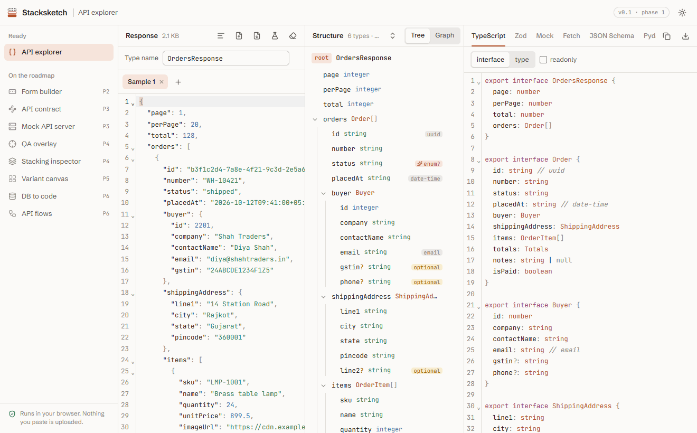
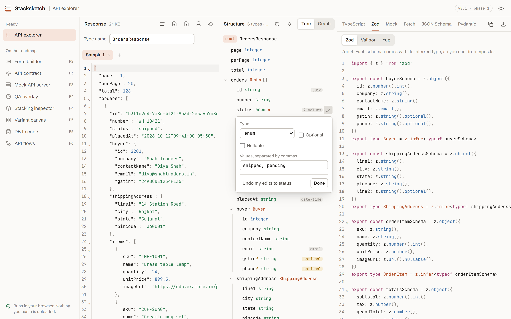
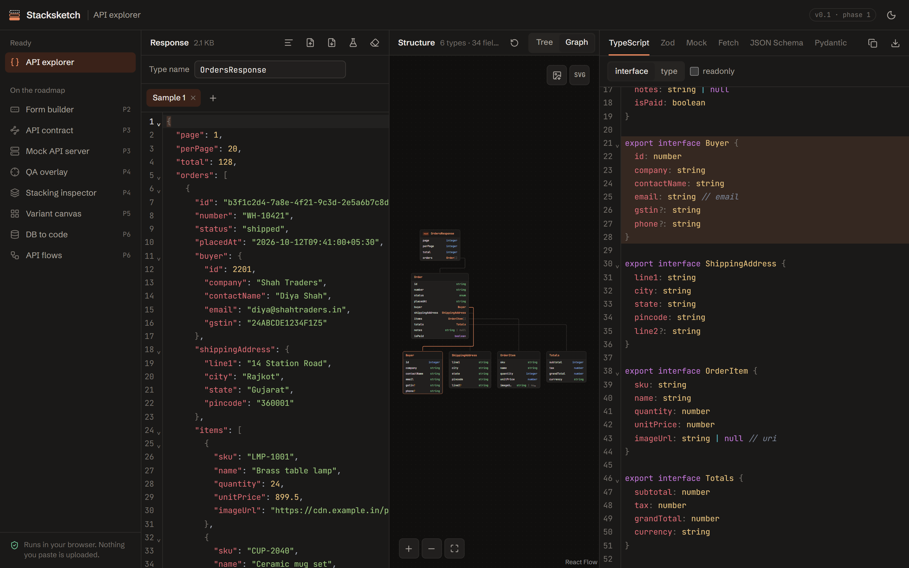
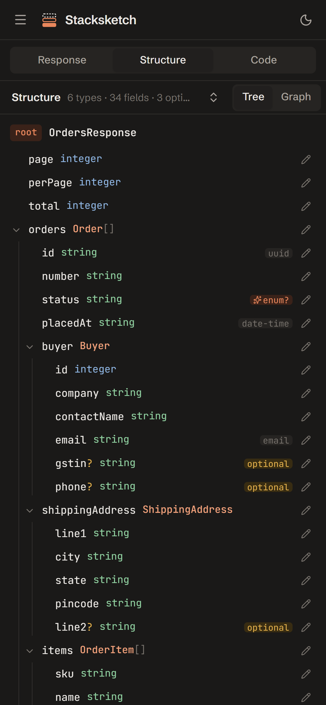

# Stacksketch

**One local workbench for the contract between frontend and backend.**

Paste an API response and get TypeScript types, a Zod, Valibot or Yup schema, realistic mock data, a typed fetch, Axios or TanStack Query client, JSON Schema, Pydantic models and Go structs in one go. The form builder turns any of those types into a form with validation and conditional fields, and the API contract designer puts them on endpoints and exports OpenAPI 3.1 and a typed client. Later phases add a mock API server and a browser extension for pixel-perfect QA, all reading the same shared schema.

Free, open source, no account, no backend. Everything runs in your browser and nothing you paste is uploaded.

> Status: **v0.1.0, phase 1** (API explorer), with phase 2 (the form builder) and the first half of phase 3 (the API contract designer) built and waiting for their release. See [CHANGELOG.md](CHANGELOG.md) for what's in it and [ROADMAP.md](ROADMAP.md) for what's next.



| Light, editing a field | Dark, graph view | Phone |
| --- | --- | --- |
|  |  |  |

## What works today

### API explorer

- Paste a JSON response, open `.json` files, or start from the sample.
- **Several samples at once**: add a tab per response from the same endpoint and they merge into one schema, which is the surest way to find optional fields. A tab with broken JSON is left out until you fix it.
- **Import from DevTools**: pick responses out of a HAR file (Network → "Save all as HAR with content"), or paste a "Copy as cURL" command to set up the client code. Both are read locally; nothing is sent.
- **Structure tree**: every nested object as a named type, with optional and nullable fields, detected formats (`uuid`, `email`, `date-time`, `date`, `uri`) and integer vs decimal numbers. Hover a field to see sample values.
- **Edit the schema**: click the pencil on any field to change its type or format, mark it optional, required or nullable, turn a string into an enum of its sample values, or rename the type it holds. Fields like `status` and `currency` offer "enum?" in one click. Edits live on top of inference, so they survive a reload and pasting a new sample, and every output picks them up.
- **Graph view**: switch the Structure pane from Tree to Graph to see one card per type with an edge for each reference, laid out automatically. Click a card to highlight its declaration in the generated code. Pan and pinch-zoom by touch, and export the graph as PNG or SVG.
- **TypeScript**: `interface` or `type`, optional `readonly`, format notes as comments.
- **Validation**: Zod 4, Valibot 1 or Yup 1 schemas, each with its inferred type and the right checks for emails, UUIDs, URLs and dates.
- **Mock data**: realistic, seeded fake data that passes its own Zod schema. It reuses real values from your sample for fields like `status` and `currency`.
- **Client code**: a typed `fetch` wrapper, an Axios function or a TanStack Query hook (`useQuery` for GET, `useMutation` otherwise). Path params (`/users/:id` or `/users/{id}`) become arguments, and the response is validated with Zod (or just cast, if you prefer).
- **Pydantic and Go**: Pydantic v2 models with snake_case fields and aliases, and Go structs with `json` tags, pointers for nullable fields and named types for enums.
- **JSON Schema** (draft 2020-12), ready for OpenAPI 3.1.
- Arrays of objects are merged, so a key missing from some items becomes optional and a key that's sometimes `null` becomes nullable.
- Big responses (over about 500 KB) are parsed in a Web Worker, so typing stays smooth.
- Clear JSON errors with line and column ("Trailing comma before '}'"), and a click jumps to the spot.
- Copy or download every output. Light and dark themes. Works at phone width.

### Form builder

- **Drag fields onto a form**: text (plain, email, URL, phone, password), paragraph, number, dropdown, radio, checkbox, date (with or without a time) and file. Drag from the list, or click to add below the selected field.
- **Reorder** by dragging a field's handle, from the keyboard (focus the handle, Space, arrow keys, Space), or with Alt + ↑ / ↓ on a selected field.
- **Sections and steps**: drop a Section to group the fields below it under a heading, or a Step to start a new page of a multi-step form.
- **Start from a type**: pick any type the API explorer found (with your schema edits) and get its fields with types and required-ness filled in. Nested objects become sections with dotted keys (`buyer.email`). Lists, mixed types and server-set keys like `id` and `createdAt` are left out, and the dialog says why.
- **Validation per field**: required, min and max (characters for text, the value for numbers, megabytes for files), a regex pattern, and your own message for each rule. Default messages are plain English, built from the label ("Enter GST number").
- **Conditional fields**: show a field only when another one is, isn't, is filled in or is empty ("show GST number only if business type is company"). It's only required while it shows.
- **Zod schema** for the form's values, with every rule and message. Conditional fields are checked when they show, even while other fields still have errors, so multi-step forms validate step by step.
- **React component**: a React Hook Form + Zod component styled with Tailwind, next to its schema file. Steps check their own fields before moving on, hidden fields drop out of the values, inputs are labelled and wired to their hints and errors for screen readers, and it builds unedited in a fresh Vite app (`pnpm add react-hook-form @hookform/resolvers zod`).
- **Preview**: switch the canvas to Preview and fill the form in. It validates with the exact schema you'd export, walks through the steps, shows and hides conditional fields, and shows the values `onSubmit` would get.
- Problems are marked on the form (a duplicate key, a regex that doesn't compile, a condition on a field that's gone), and the code leaves those parts out until they're fixed, so it always compiles.
- Several forms, kept in your browser. Delete a field or a form and undo it from the toast.

### API contract

- **Endpoints**: method, path (`/orders/{orderId}` or `/orders/:orderId`), summary, description, path and query params, a JSON request body and a response per status code, including `default` for "any other status". Endpoints are grouped by resource (the OpenAPI tag).
- **Shared types**: bodies, responses and params point at the contract's types, so one `Order` serves every endpoint. Edit a type's fields (any value kind, a format, an enum, another type, a list, nullable, optional), rename it everywhere at once, and see what uses it before you delete it.
- **From the API explorer**: add the explorer's response (with your schema edits) as an endpoint. The URL is split into the base URL, the path and query params; types that are already in the contract are reused, and different ones with the same name are renamed.
- **OpenAPI 3.1 export** as YAML or JSON, with every type under `components/schemas`.
- **OpenAPI import**: open or paste an OpenAPI 3.0 or 3.1 file, YAML or JSON. Object schemas become types (inline ones are named from where they sit, like `CreateOrderBody`), `$ref`s, `allOf`, `oneOf`/`anyOf`, `nullable` and `type: [x, "null"]` are understood, and anything the shared schema can't hold yet (header params, maps, non-JSON bodies) is listed in plain words. It's read in your browser and you can undo it.
- **Typed client**: one `fetch` function per endpoint with path params as arguments, query params as an object, a **typed request body**, and the success response as the return type, checked with Zod (or cast). Error statuses throw an `ApiError` with the status and body. It comes with the contract's TypeScript types and Zod schemas (recursive types included), and compiles under strict `tsc`.
- **Mock server**: set a delay or a forced status per endpoint, download `contract.json`, and serve it (see below).
- Problems are listed and marked in the list (a duplicate route, a query param that's an object, a body on a GET, a type that's gone); those parts are left out of the code until they're fixed, so the code always compiles.

### Mock API server

```bash
pnpm build                                          # builds packages/cli/dist/cli.js
node packages/cli/dist/cli.js mock contract.json    # npx stacksketch mock contract.json, once published
```

- Serves every endpoint of a contract exported from the workbench, or of an OpenAPI 3.0 / 3.1 file (JSON or YAML), at `http://localhost:4010` under the base URL's path.
- Data comes from the same generator as the explorer's mock tab, the same for the same URL, with path params filled in (`/orders/42` answers with `id: 42`).
- Per-endpoint delay and forced status from the contract; `?__status=500` or `?__delay=2000` (or `x-mock-status` / `x-mock-delay` headers) on any request; `--delay` for all of them.
- In-memory CRUD: POST then GET returns what you created, and PATCH, PUT and DELETE change it (`--no-crud` turns it off).
- CORS on, plain-English 404s and 405s, a 400 when a required JSON body is missing, and it reloads when you save the file. Options: `--port`, `--host`, `--seed`, `--base`, `--help`.

## Run it locally

You need Node 20.19+ and pnpm.

```bash
pnpm install
pnpm dev        # http://localhost:5174
```

Other commands, from the repo root:

```bash
pnpm test       # unit tests (packages/core)
pnpm typecheck
pnpm lint
pnpm build      # builds apps/web into apps/web/dist
```

## How the repo is laid out

```
apps/
  web/              the workbench (Vite + React + Tailwind)
packages/
  core/             @stacksketch/core: the shared schema format, inference and code generators (pure TypeScript, no DOM)
```

`packages/cli` is the mock API server (`stacksketch mock`). Coming in later phases: `apps/extension` (QA overlay and stacking inspector) and a Vite/Next plugin for the variant canvas.

## The shared schema

Every module speaks one format, defined in `packages/core/src/types.ts`. Objects are named types, and fields point at them with refs:

```ts
{ version: 1, rootName: 'OrdersResponse', root: { kind: 'ref', name: 'OrdersResponse' }, types: [/* Order, Buyer, … */] }
```

The API explorer creates it, the form builder turns it into fields (and gives one back for the form's values), and the contract designer will attach it to endpoints. That's what lets a response become types, then a form, then a mocked endpoint, without retyping anything.

## Sibling project

Schemasketch draws database diagrams from DBML. Phase 6 connects the two, so a diagram can become Prisma schema, migrations and CRUD endpoints here.

## License

MIT
